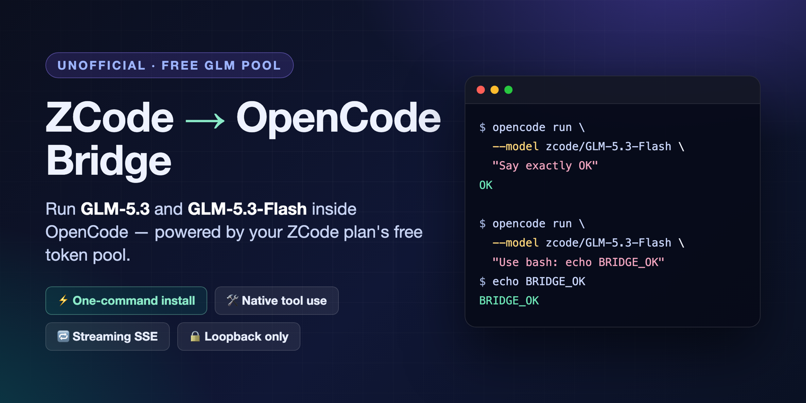
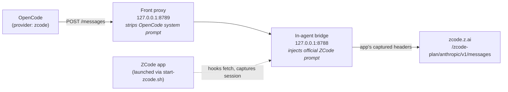

<p align="center">
  
</p>

<h1 align="center">ZCode → OpenCode Bridge</h1>

<p align="center">
  <strong>Run GLM-5.3 and GLM-5.3-Flash inside OpenCode — powered by your ZCode plan's free token pool.</strong>
</p>

<p align="center">
  <a href="https://github.com/Parithosh-Varma/zcode-opencode-bridge/actions/workflows/ci.yml"></a>
  <a href="LICENSE"></a>
  
  = 18">
  
</p>

---

## 💡 Why

ZCode ships with a generous free GLM token pool — but it's locked to the ZCode app.
OpenCode is a great terminal coding agent — but you have to bring your own (paid) API key.

**This bridge connects the two.** It runs a tiny local proxy *inside* ZCode's own agent
process, reuses the app's authenticated session, and exposes a standard
Anthropic-compatible endpoint that OpenCode connects to. No API key. No Coding Plan
subscription. Just your existing ZCode plan.

```text
✅ 300,000,000 free units (GLM-5.3-Flash) + 200,000,000 (GLM-5.3) with the ZCode 1024 Dev Day plan
```

## ✨ Features

| | |
|---|---|
| ⚡ **One-command install** | `./install.sh` patches your local ZCode agent and sets up a LaunchAgent |
| 🛠 **Native tool use** | OpenCode's bash/read/edit tools work end-to-end |
| 🔁 **Streaming SSE** | Real-time token streaming, fully piped through |
| 🧠 **Auto warm-up** | Captures the app's session automatically on your first ZCode message |
| 🔒 **Loopback only** | Binds to `127.0.0.1` — nothing leaves your machine except model calls |
| 🔐 **No stored credentials** | Auth lives in memory inside the agent process; never written to disk |
| 🧹 **Clean uninstall** | Two commands and it's gone |

## 🚀 Quick start

```bash
git clone https://github.com/Parithosh-Varma/zcode-opencode-bridge.git
cd zcode-opencode-bridge
./install.sh
```

Then:

1. **Quit ZCode** completely
2. **Relaunch it** through the bridge:
   ```bash
   ~/.config/opencode/zcode-bridge/start-zcode.sh
   ```
3. **Send one message** in any ZCode task (e.g. `hi`) — this warms up the bridge
4. **Verify:**
   ```bash
   curl -s http://127.0.0.1:8789/health
   # {"ok":true,...}
   ```
5. **Add the provider** from [`opencode.json.example`](opencode.json.example) to `~/.config/opencode/opencode.json`, then:

```bash
opencode run --model zcode/GLM-5.3-Flash "Say exactly OK"
# OK

opencode run --model zcode/GLM-5.3-Flash \
  "Use the bash tool to run 'echo BRIDGE_OK' and report the output."
# $ echo BRIDGE_OK
# BRIDGE_OK
```

Or just pick `zcode/GLM-5.3-Flash` in OpenCode's model picker and use it interactively.

## 🏗 How it works



The ZCode gateway rejects any request whose top-level `system` prompt isn't the
official ZCode one:

```json
{"code": 3012, "msg": "request has been blocked due to unusual activity."}
```

So the bridge does a two-step swap:

1. The **front proxy** removes OpenCode's system prompt and adds a short note to the first user message
2. The **in-agent hook** captures the app's own official system prompt on its next model call and injects the first two blocks (ZCode's stable identity prompt) into every forwarded request

Everything else — OpenCode's tools, messages, and streaming — passes through untouched.

<details>
<summary><b>📦 What exactly gets captured and injected?</b></summary>

When ZCode makes a model request, the hook stores **in memory only**:

- Request headers (auth, session ID, client fingerprint)
- The first two blocks of the official system prompt (the "identity" prompt)
- The app's `metadata` and `max_tokens` cap

It deliberately **ignores** auxiliary requests (title generators, summaries) so a
background title call can't overwrite the real agent prompt.

OpenCode's requests get the identity prompt + the app's metadata. Your conversation
and tools flow through as-is.

</details>

## 📋 Requirements

- macOS
- [ZCode](https://z.ai) desktop app (tested with 3.16.3)
- Node.js 18+
- [OpenCode](https://opencode.ai)

## ⚙️ Install options

```bash
# Custom install directory
ZCODE_BRIDGE_DIR="$HOME/zcode-bridge" ./install.sh

# Skip the LaunchAgent, run the front proxy manually
./install.sh --no-launchd
```

The installer:
- Copies your installed ZCode agent to `~/.config/opencode/zcode-bridge/agent` and injects the hook (the app itself is **never modified**)
- Creates `start-zcode.sh` / `start-front.sh`
- Installs and starts a LaunchAgent for the front proxy

## ⚠️ Important usage notes

- **Always launch ZCode via `start-zcode.sh`** — opening it from the Dock uses the unpatched agent and the bridge won't exist
- **ZCode must stay running** while OpenCode uses the bridge
- If you restart ZCode, send one message in a task to re-warm the bridge

<details>
<summary><b>🔧 Troubleshooting</b></summary>

**`503 bridge_not_ready`** — the bridge hasn't captured a session yet.
Restart ZCode via `start-zcode.sh` and send one message in a task.

**`405` with `"code":3012`** — the gateway didn't see the official prompt.
Same fix: relaunch via `start-zcode.sh`, warm up with one message.

**`EADDRINUSE` on 8788/8789** — another ZCode instance or proxy is running.
Quit all ZCode processes, then restart via `start-zcode.sh`.

**OpenCode can't connect** — start the front proxy:
```bash
launchctl kickstart -k "gui/$(id -u)/com.zcode-bridge.front"
```

</details>

<details>
<summary><b>❓ FAQ</b></summary>

**Is this an API key?** No. It reuses your ZCode app's authenticated session. No keys are stored anywhere.

**Does this cost money?** It consumes your ZCode plan's free token pool. Nothing else.

**Will it break?** Possibly — if ZCode changes its gateway rules or agent bundle layout. Pinned/tested against 3.16.3.

**Can I use other clients?** Anything that speaks the Anthropic Messages API can point at `http://127.0.0.1:8789`.

**Is this allowed?** Unofficial and likely against ZCode's ToS. Use at your own risk with your own account.

</details>

## 🔐 Privacy & security

- Auth headers live **in memory** inside the agent process — never written to disk
- Both servers bind to `127.0.0.1` only
- `ZCODE_DEBUG=1` enables metadata-only logs (no headers, no bodies)
- This repo contains **zero credentials** and does **not** redistribute the ZCode app — the installer copies it from your own installation

## 🗑 Uninstall

```bash
launchctl bootout "gui/$(id -u)" ~/Library/LaunchAgents/com.zcode-bridge.front.plist 2>/dev/null || true
rm -f ~/Library/LaunchAgents/com.zcode-bridge.front.plist
rm -rf ~/.config/opencode/zcode-bridge
```

Then remove the `zcode` provider from your OpenCode config.

## ⚖️ Disclaimer & license

This project is **unofficial** and not affiliated with ZCode, Z.ai, or OpenCode.
It may stop working at any time and may violate ZCode's terms of service. Use your
own account. No warranty.

[MIT](LICENSE) © Parithosh Varma

---

<p align="center">Found this useful? <b>⭐ Star the repo</b> to help others find it.</p>
